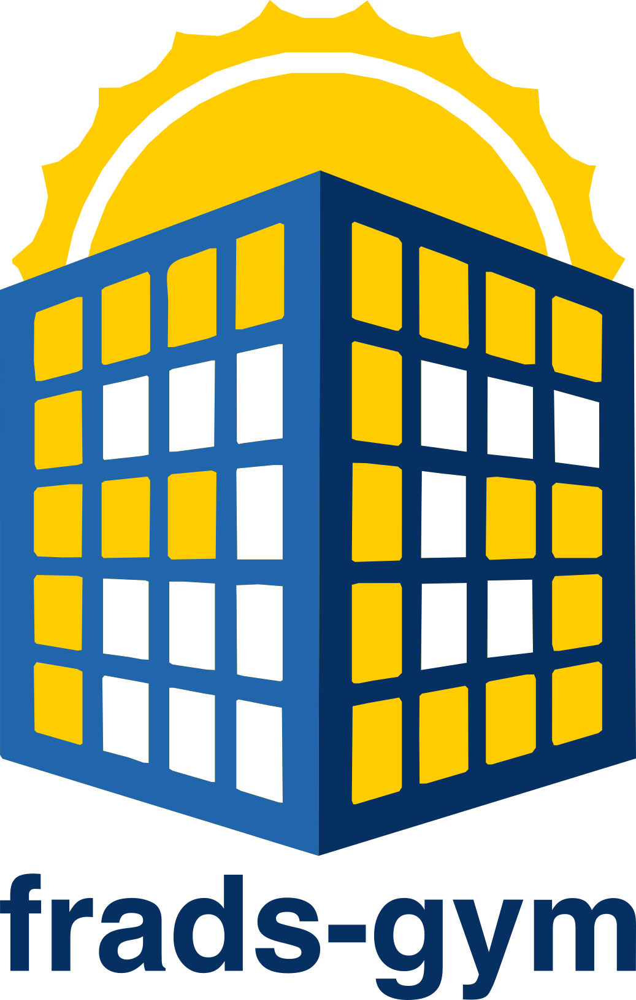

# frads-gym

{ width="160" align=right }

`frads-gym` is a [Gymnasium](https://gymnasium.farama.org/) environment for controlling switchable
facades, such as electrochromic glazing, with reinforcement learning. It couples
[EnergyPlus](https://energyplus.net/) for the thermal and energy simulation with
[Radiance](https://www.radiance-online.org/) for daylight and glare, both through
[frads](https://github.com/LBNL-ETA/frads), and hands control to the agent at every EnergyPlus
timestep.

## What it does

- **One step per timestep.** EnergyPlus runs in a background thread and pauses at the end of every zone
  timestep; `step(action)` sets the glazing state of each controlled window and lets the coupled
  simulation advance by one timestep. See [How it works](how-it-works.md).
- **Configuration instead of code.** Observations, actions and their normalisation are declared in one
  JSON document: EnergyPlus output variables, the current glazing state, work-plane or point
  illuminance (three-phase method), enhanced simplified DGP, daylight-dimmed lighting energy, energy
  sums and allocations, and a transient thermal model of absorbing glazing. See
  [Configuration](configuration.md).
- **Built for training.** Per-observation normalisation (static, windowed percentile, Welford, windowed
  and EMA z-score), episodes that end at day or month boundaries without restarting EnergyPlus,
  staggered start months for parallel environments, and [wrappers](wrappers.md) for action repeat,
  active hours, a solar forecast and observation history.
- **Reproducible.** A fixed set of Radiance matrices makes runs bit-for-bit repeatable; invalid
  configurations fail at construction with every problem listed.
- **Plain `pip install`.** EnergyPlus and Radiance arrive as Python wheels through `pyenergyplus-lbnl`
  and `pyradiance`. See [Installation](installation.md).

## A first look

```python
from frads_gym import FradsEnv

env = FradsEnv(
    output_dir="output",
    config_file="config.json",
    weather_files_path=["weather.epw"],
    reward_function=lambda obs, action, next_obs, info: 0.0,
    number_of_timesteps_per_hour=4,
)
obs, info = env.reset()
for _ in range(96):
    obs, reward, terminated, truncated, info = env.step(env.action_space.sample())
    if terminated or truncated:
        break
env.close()
```

The [Quickstart](quickstart.md) builds a complete, runnable configuration without any downloaded data.

## Citing

Please cite the archived release you used. The concept DOI
[10.5281/zenodo.18504304](https://doi.org/10.5281/zenodo.18504304) resolves to the latest version;
`CITATION.cff` in the repository holds the metadata. frads-gym builds on frads, EnergyPlus and Radiance;
please cite those as well.

## License

MIT. frads-gym was written by Silas Kalmbach.
